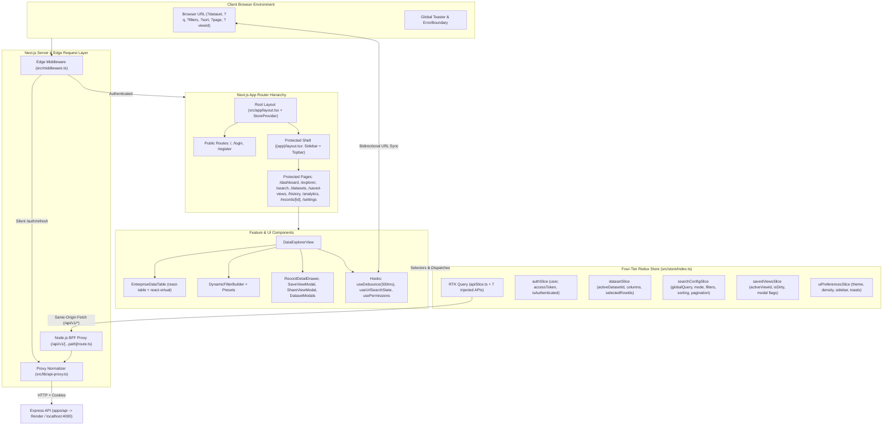
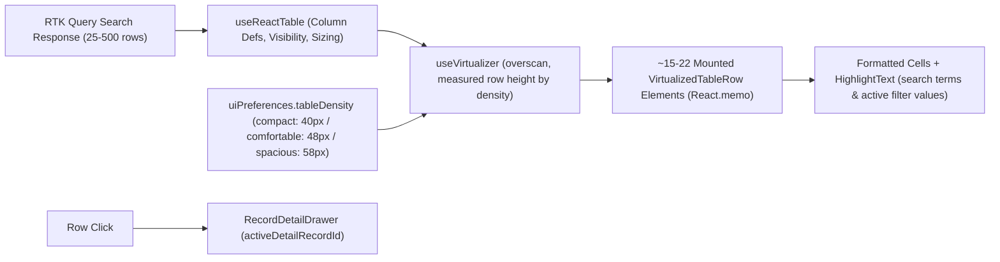

# 01 — Frontend Architecture Diagram

> **Application Package:** `apps/web` (`@datascope/web`)  
> **Framework:** Next.js (App Router) · React · TypeScript · Tailwind CSS  
> **State & Data Layer:** Redux Toolkit + RTK Query (`apiSlice`) + `@tanstack/react-table` + `@tanstack/react-virtual` + `recharts`

---

## 1. High-Level Frontend System Architecture

---

## 2. Routing, Middleware & BFF Proxy Topology

### 2.1 App Router Segment Organization

| Route Group / Path | File | Protection & Rendering | Primary Responsibility |
| :--- | :--- | :--- | :--- |
| `(public)/` | `src/app/(public)/page.tsx` | Public (`static`) | Enterprise landing showcase, architecture highlights, and workspace entry links |
| `(public)/login` | `src/app/(public)/login/page.tsx` | Redirects to `/explorer` if authenticated | Credential sign-in, quick demo role logins, Zod validation, post-auth redirect |
| `(public)/register` | `src/app/(public)/register/page.tsx` | Redirects to `/explorer` if authenticated | New Analyst / Viewer registration (`ADMIN` self-registration blocked) |
| `(app)/dashboard` | `src/app/(app)/dashboard/page.tsx` | Protected | Workspace KPI summary, quick dataset shortcuts, recent saved views |
| `(app)/explorer` | `src/app/(app)/explorer/page.tsx` | Protected | Core workspace hosting `DataExplorerView`, `DynamicFilterBuilder`, `EnterpriseDataTable`, and `RecordDetailDrawer` |
| `(app)/search` | `src/app/(app)/search/page.tsx` | Protected | Dedicated multi-clause search workbench sharing search/filter selectors |
| `(app)/datasets` | `src/app/(app)/datasets/page.tsx` | Protected | Dataset library, field schema modal, Admin create/delete/permission assignment modals |
| `(app)/saved-views` | `src/app/(app)/saved-views/page.tsx` | Protected | Personal & team-shared view directory with one-click deep linking into `/explorer?viewId=...` |
| `(app)/history` | `src/app/(app)/history/page.tsx` | Protected | Audit log of executed queries, filter summaries, match counts, and latency telemetry |
| `(app)/analytics` | `src/app/(app)/analytics/page.tsx` | Protected (`ADMIN` & `ANALYST`) | Recharts KPI, Area/Bar/Line/Pie visualizations powered by server SQL aggregations; Viewer role sees RBAC empty state |
| `(app)/records/[id]` | `src/app/(app)/records/[id]/page.tsx` | Protected (`dynamic`) | Full-page record intelligence view showing core fields, JSONB attributes, relationships, and history audit trail |
| `(app)/settings` | `src/app/(app)/settings/page.tsx` | Protected | Theme & table density preferences (`PUT /users/me/preferences`) plus Admin user/role management |
| `/api/v1/[...path]` | `src/app/api/v1/[...path]/route.ts` | Server Route Handler (`nodejs`, `force-dynamic`) | Same-origin BFF proxy forwarding REST traffic to `INTERNAL_API_URL` |

### 2.2 Edge Middleware & First-Party BFF Proxy Interaction

1. **Edge Route Guard (`src/middleware.ts`)**:
   - Matches protected prefixes (`/dashboard`, `/datasets`, `/explorer`, `/search`, `/saved-views`, `/history`, `/records`, `/analytics`, `/settings`) and auth routes (`/login`, `/register`).
   - Verifies `ds_access_token` using `jose` (`jwtVerify` with `JWT_ACCESS_SECRET`) at the Edge.
   - If expired/missing and `ds_refresh_token` is present on a real navigation (skipping Next.js router prefetches such as `next-router-prefetch` and `purpose: prefetch`), sends a server-side `POST ${upstreamBase}/auth/refresh` request, normalizes rotated `Set-Cookie` headers, and allows the navigation through seamlessly.
   - Attaches `x-middleware-cache: no-cache` and `Cache-Control: private, no-store, no-cache, must-revalidate` so CDN/Router caches never serve stale unauthenticated `307` redirects.
2. **BFF Node.js Route Handler (`src/app/api/v1/[...path]/route.ts` & `src/lib/api-proxy.ts`)**:
   - Browser requests go same-origin to `/api/v1/*`, keeping `ds_access_token` and `ds_refresh_token` first-party cookies on the Vercel host under `HttpOnly; SameSite=Lax; Path=/` (`Secure` on HTTPS).
   - Strips hop-by-hop headers, `Origin`, `Content-Encoding`, and `Content-Length`, preserves every `Set-Cookie` header via `headers.getSetCookie()`, removes any upstream `Domain=...` attribute, and returns `502 BAD_GATEWAY` / `503 PROXY_MISCONFIGURED` structured JSON on upstream failures.

---

## 3. Four-Tier Frontend State Architecture

DataScope enforces strict state separation so raw database records never bloat Redux slices and keystrokes remain smooth (`60fps`):

| Tier | Implementation | Stored Data | Prohibited Data |
| :--- | :--- | :--- | :--- |
| **1. Server State** | RTK Query (`apiSlice.ts` + 7 endpoint modules) | Paginated `DatasetRecordDTO[]`, dataset metadata, saved views, search history, analytics DTOs, record details | Ephemeral UI open/closed flags |
| **2. Global Client State** | 5 Redux Toolkit Slices (`src/store/slices/`) | Auth session (`authSlice`), active dataset & column layout (`datasetSlice`), active search/filter/sort config (`searchConfigSlice`), view dirty state & modals (`savedViewsSlice`), theme/density/toasts (`uiPreferencesSlice`) | Raw `DatasetRecordDTO[]` record arrays |
| **3. URL Query State** | `useUrlSearchState.ts` (`useSearchParams` + `router.replace`) | `?dataset=...&q=...&mode=...&filters=...&logic=...&sort=...&page=...&limit=...&pm=...&viewId=...` | User tokens, secrets, transient drawer state |
| **4. Component Local State** | React `useState` / `useRef` | Live uncontrolled/debounced search box string, draft filter rows before apply, column drag widths, dropdown open flags | Persistent domain records |

### Redux Slice Responsibilities (`src/store/index.ts`)

- **`authSlice`**: Tracks `{ user, accessToken, isAuthenticated, isInitialized }`. Automatically populated via `extraReducers` matchers on `login`, `register`, `refreshToken`, `getMe`, and cleared on `logout` or failed `refreshToken`.
- **`datasetSlice`**: Tracks `{ activeDatasetId, columnVisibility, columnSizing, selectedRowIds }`. Clearing `activeDatasetId` automatically resets `selectedRowIds`.
- **`searchConfigSlice`**: Tracks `{ globalQuery, searchMode, filters, logicOperator, sorting, pagination: { page, pageSize, mode, cursor } }`. Mutating queries, filters, sorting, or mode resets pagination back to page 1 (`cursor = null`).
- **`savedViewsSlice`**: Listens to `searchConfigSlice` mutation actions via `addMatcher` and marks `isDirty = true` whenever an active saved view's parameters diverge from the saved baseline.
- **`uiPreferencesSlice`**: Syncs persisted database preferences (`tableDensity`, `theme`) whenever `login`, `register`, `getMe`, or `updateMyPreferences` resolves, and manages the toast queue (capped at 5 active toasts).

---

## 4. High-Density Presentation & Data Grid Engineering

- **Row Virtualization (`@tanstack/react-virtual`)**: `EnterpriseDataTable.tsx` calculates row height dynamically from `tableDensity` (`40px` compact, `48px` comfortable, `58px` spacious) and transforms only the visible rows inside the scroll viewport, keeping DOM node counts constant regardless of page size (`25`–`500`).
- **Role-Aware Rendering (`usePermissions`)**: Wraps `ROLE_CAPABILITIES` from `@datascope/shared` (`can('views:save')`, `can('analytics:view')`, `can('data:export')`, `can('datasets:manage')`) alongside per-dataset `effectivePermissions` returned by `GET /datasets/:id`.
- **Resilient Auth Hydration (`StoreProvider` -> `ThemeAndAuthSynchronizer`)**: Synchronizes Tailwind `.dark` class on `<html>` with `uiPreferences.theme`, executes `useGetMeQuery(undefined, { skip: isInitialized || isPublicRoute })` on protected routes, and redirects cleanly in `(app)/layout.tsx` if session initialization concludes unauthenticated.

---

## 5. Production Build Footprint

Verified from `pnpm build` (Next.js production build on commit `5f544f9`):

| Route | Type | Route Size | First Load JS | Notes |
| :--- | :---: | :---: | :---: | :--- |
| `/` | Static (`○`) | `4.71 kB` | `150 kB` | Public platform overview |
| `/explorer` | Static shell (`○`) | `33.6 kB` | `212 kB` | Hosts `@tanstack/react-table` + `@tanstack/react-virtual` explorer |
| `/analytics` | Static shell (`○`) | `123 kB` | `286 kB` | Code-split `recharts` analytics charts (`optimizePackageImports`) |
| `/api/v1/[...path]` | Dynamic (`ƒ`) | `123 B` | `103 kB` | Runtime Node.js BFF Route Handler proxy |
| `/records/[id]` | Dynamic (`ƒ`) | `4.68 kB` | `151 kB` | Standalone record profile, relationships & history |
| `Middleware` | Edge (`ƒ`) | — | `40.5 kB` | `jose` Edge JWT guard & transparent refresh |
| Shared JS Chunk | Shared | — | `103 kB` | Common framework, Redux store & RTK Query base runtime |
