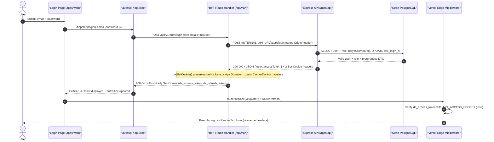
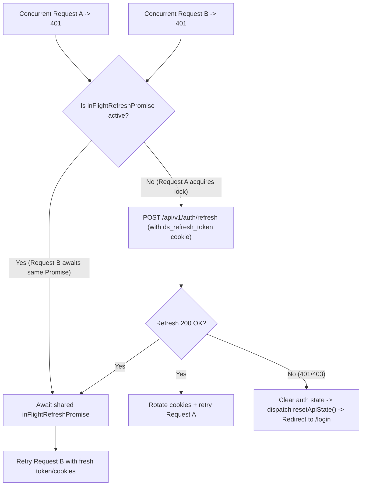

# 02 — Data Fetching Flow Diagram

> **Primary Modules:** `apps/web/src/services/*.ts`, `apps/web/src/lib/api-proxy.ts`, `apps/web/src/middleware.ts`, `apps/web/src/hooks/useUrlSearchState.ts`, `apps/web/src/features/data-explorer/DataExplorerView.tsx`

---

## 1. Authentication, BFF Cookie Flow & Protected Navigation

In production (Vercel + Render + Neon), browser requests are kept same-origin via the Next.js Node.js BFF proxy (`/api/v1/[...path]`), ensuring `HttpOnly` cookies bind directly to the Vercel domain (`SameSite=Lax; Secure; Path=/`) where Edge Middleware verifies them.



---

## 2. Interactive Discovery, Debouncing, URL Sync & Cache Pipeline

```mermaid
sequenceDiagram
    autonumber
    actor Analyst
    participant SearchInput as "Search Input / Filter Builder"
    participant Debounce as "useDebounce(300ms)"
    participant ReduxCfg as "searchConfigSlice"
    participant URLSync as "useUrlSearchState"
    participant RTKQ as "recordsApi (apiSlice)"
    participant BFF as "BFF /api/v1/datasets/:id/records/search"
    participant SearchSvc as "search.service.ts + TtlCache"
    participant DB as "PostgreSQL (GIN + B-Tree)"

    Analyst->>SearchInput: Types "Quantum" (multiple keystrokes)
    Note over SearchInput,Debounce: Typing stays local 60fps; timer resets on each keystroke
    Debounce-->>ReduxCfg: dispatch(setGlobalQuery("Quantum")) after 300ms pause
    ReduxCfg->>ReduxCfg: Resets pagination.page = 1 and cursor = null
    ReduxCfg-->>URLSync: Selector change detected
    URLSync->>URLSync: router.replace("/explorer?dataset=...&q=Quantum", scroll: false)
    ReduxCfg-->>RTKQ: useSearchRecordsQuery({ datasetId, query }) fires
    alt Cache Hit in RTK Query (within 120s keepUnusedDataFor)
        RTKQ-->>Analyst: Instant 0ms render from normalized client cache
    else Client Cache Miss -> Network Request
        RTKQ->>BFF: POST /api/v1/datasets/:id/records/search
        BFF->>SearchSvc: Forward request + HttpOnly cookies
        alt Warm Server Hit in TtlCache (500-entry LRU, 120s TTL)
            SearchSvc-->>RTKQ: Return cached rows + meta.cacheHit = true (~0.01ms server time)
        else Cold DB Query
            SearchSvc->>DB: Parallel SELECT rows (LIMIT/OFFSET or Keyset) + COUNT/datasets.total_records
            DB-->>SearchSvc: Rows + Total Count
            SearchSvc->>SearchSvc: Store in searchResultCache + async INSERT search_history
            SearchSvc-->>RTKQ: Return JSON { data, meta } + meta.cacheHit = false
        end
        RTKQ->>RTKQ: onQueryStarted -> invalidateTags(['SearchHistory'])
    end
```

---

## 3. Silent `401` Re-Authentication Mutex Flow

Concurrent component requests triggered right after an access token expires (every `15m`) are serialized through a shared `inFlightRefreshPromise` in [`apiSlice.ts`](../../apps/web/src/services/apiSlice.ts) so only one refresh round-trip hits the backend.



---

## 4. RTK Query Tag Invalidation & Caching Matrix

Configured in [`apiSlice.ts`](../../apps/web/src/services/apiSlice.ts) (`refetchOnFocus: false`, `refetchOnReconnect: true`, `refetchOnMountOrArgChange: 60` default, per-endpoint overrides below):

| API Module | Endpoint | Cache Retention (`keepUnusedDataFor`) | `providesTags` | Triggers `invalidatesTags` / Side Effects |
| :--- | :--- | :---: | :--- | :--- |
| `authApi` | `getMe` | `60s` | `['Auth']` | Populates `authSlice` & `uiPreferencesSlice` |
| `authApi` | `login`, `register`, `logout` | — | — | `login`/`register` set credentials; `logout` invalidates `'Auth'` and calls `apiSlice.util.resetApiState()` |
| `datasetsApi` | `getDatasets`, `getDatasetById` | `300s` | `Datasets` (`id` / `'LIST'`) | Invalidated by `createDataset`, `updateDataset`, `deleteDataset`, `updateDatasetPermissions` |
| `datasetsApi` | `getDatasetPermissions` | `60s` | `DatasetPermissions` (`datasetId`) | Invalidated by `updateDatasetPermissions` (also refreshes `Datasets`) |
| `recordsApi` | `searchRecords` | `120s` | `Records` (`datasetId`) | `onQueryStarted` invalidates `'SearchHistory'` when query/filters executed (`recordHistoryLog !== false`) |
| `recordsApi` | `getRecordDetail` | `180s` | `RecordDetail` (`recordId`) | Cached per individual record UUID for drawer/detail revisits |
| `savedViewsApi` | `getSavedViews`, `getSavedViewById` | `60s` | `SavedViews` (`id` / `'LIST'`) | Invalidated by `createSavedView`, `updateSavedView`, `shareSavedView`, `deleteSavedView` (mutations also invalidate `'Analytics'`) |
| `historyApi` | `getSearchHistory`, `clearSearchHistory` | `60s` | `SearchHistory` | `clearSearchHistory` invalidates `'SearchHistory'` and `'Analytics'` |
| `analyticsApi` | `getAnalyticsOverview` | `180s` | `['Analytics']` | Invalidated by dataset create/delete, saved view create/delete, and search history clear |
| `usersApi` | `getMyPreferences`, `updateMyPreferences` | `60s` | `['Preferences']` | Optimistically patches `getMyPreferences` via `updateQueryData` with automatic `.undo()` rollback on HTTP failure; invalidates `'Preferences'`, `'Auth'` |
| `usersApi` | `getUsers`, `getRoles`, `updateUserRole` | `60s` | `['Users']` | `updateUserRole` invalidates `['Users']` |

---

## 5. Resilience, Slow Network & Million-Row Data Fetching Guarantees

1. **Deduplication & Race Prevention**: Multiple components subscribing to `useGetDatasetsQuery()` (e.g., `Topbar` and `DataExplorerView`) trigger a single HTTP call via RTK Query's deterministic cache key serialization. Rapid filter changes automatically ignore out-of-order responses from older argument snapshots.
2. **Skeleton vs. Stale-While-Fetching UX**:
   - First load (`isLoading === true`) renders structural skeletons (`TableSkeleton`, `CardSkeleton`) matching exact table density to prevent Cumulative Layout Shift.
   - Filter/sort/page changes (`isFetching === true` with existing cached `data`) retain visible rows cleanly with subtle progress feedback rather than flashing empty tables on slow links.
3. **Resolving Client Base URL Safely**: `resolveClientApiBaseUrl()` in [`apiSlice.ts`](../../apps/web/src/services/apiSlice.ts) uses `NEXT_PUBLIC_API_URL` when set, defaults to `'/api/v1'` in non-localhost browsers and production environments, and keeps `'http://localhost:4000/api/v1'` in local development/test runs.
4. **Scaling Behavior (`100K -> 10M+` Rows)**: Only `10`–`500` rows per page (`~25 KB` JSON) and pre-aggregated analytics JSON (`< 4 KB`) ever traverse the network, while `EnterpriseDataTable` renders only the visible viewport slice via `@tanstack/react-virtual`.
