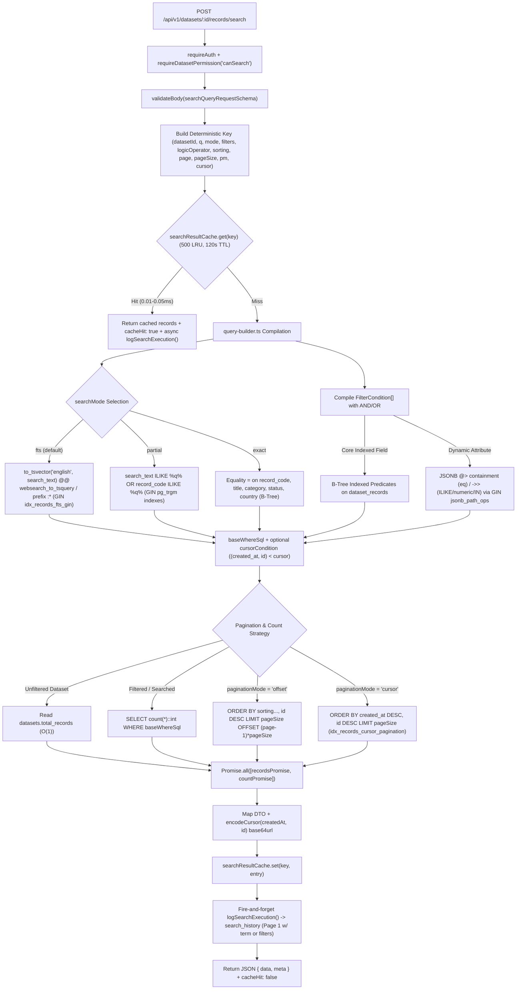

# 03 — Search Architecture Diagram

> **Backend Modules:** `apps/api/src/modules/search/`, `apps/api/src/utils/query-builder.ts`, `apps/api/src/utils/ttl-cache.ts`, `apps/api/src/db/schema/records.ts`

---

## 1. Hybrid Query Execution & Cache Pipeline

---

## 2. Three-Way Search Mode Mechanics

DataScope implements three user-selectable search modes backed by [`query-builder.ts`](../../apps/api/src/utils/query-builder.ts#L75-L126) and [`migrate.ts`](../../apps/api/src/db/migrate.ts#L110-L133):

1. **Full-Text Search (`fts` — Default)**:
   - Evaluates `to_tsvector('english', search_text) @@ websearch_to_tsquery('english', $query)` OR `to_tsquery('english', 't1:* & t2:*')` built from sanitized tokens for instant prefix completion.
   - Automatically falls back to `record_code ILIKE '%query%'` when numeric codes or dashed identifiers (`^[A-Za-z]+-\d+` such as `ENT-050000`) are entered.
   - Backed by GIN expression index `idx_records_fts_gin`.
2. **Partial Substring / Code Match (`partial`)**:
   - Compiles `search_text ILIKE '%query%' OR record_code ILIKE '%query%'`.
   - Accelerated by `CREATE EXTENSION pg_trgm` and dual trigram GIN indexes (`idx_records_trigram_gin`, `idx_records_code_trigram_gin`).
3. **Exact Equality (`exact`)**:
   - Compiles exact `=` predicates across `record_code`, `title`, `category`, `status`, and `country`.
   - Directly hits B-Tree index `idx_records_dataset_code` for deterministic `O(log N)` record ID lookups.

---

## 3. Dynamic Filter & Sort Compiler (`query-builder.ts`)

All field identifiers are validated twice: first by `safeFieldKeySchema` (`/^[a-zA-Z][a-zA-Z0-9_]*$/`, max 100 chars) via Zod middleware, and again in `buildSingleFilterConditionSql` and `buildOrderByClauses`. Zero user strings are ever concatenated directly into raw SQL syntax; every value uses Drizzle parameterized bindings.

| Field Storage Target | Operators Supported | Generated SQL Strategy | Backing Index |
| :--- | :--- | :--- | :--- |
| **Core Columns** (`recordCode`, `title`, `category`, `status`, `country`, `revenue`, `employeeCount`, `riskScore`, `createdAt`, `updatedAt`) | `eq`, `neq`, `contains`, `startsWith`, `gt`, `gte`, `lt`, `lte`, `between`, `in`, `lastNDays` | Typed column predicates (including UTC day-range `[startOfDay, +86400s)` for `eq` on `timestamptz`) | `idx_records_composite_discovery`, `idx_records_dataset_category_status`, `idx_records_dataset_code`, `idx_records_dataset_revenue`, `idx_records_dataset_employees` |
| **Dynamic `attributes` (`jsonb`)** | `eq`, `neq`, `contains`, `startsWith`, `gt`, `gte`, `lt`, `lte`, `between`, `in` | `attributes @> '{"k":v}'::jsonb` for `eq`; `(attributes->>key)` text/numeric casts for range/ILIKE/IN | `idx_records_attributes_gin` (`jsonb_path_ops`) accelerates `@>` containment |
| **Multi-Column Sorting** | Up to 5 `SortRule` entries | Compiles core column or `(attributes->>field)` + mandatory `id DESC` tie-breaker (`createdAt DESC, id DESC` fixed in `cursor` mode) | `idx_records_cursor_pagination`, `idx_records_composite_discovery` |

---

## 4. Three-Way Search Technology Comparison

| Criterion | PostgreSQL FTS (`tsvector`) | PostgreSQL Trigram (`pg_trgm`) | External Search Engine (Elasticsearch / OpenSearch) |
| :--- | :--- | :--- | :--- |
| **Text Matching Strength** | Normalized English lexeme stemming + prefix matching | Arbitrary mid-word substrings & partial codes (`%4829%`) | Full Lucene analyzers, synonyms, fuzzy BM25 scoring |
| **RBAC & Relational Filters** | Native, single ACID SQL plan (`BitmapAnd` with B-Tree) | Native, single ACID SQL plan with `dataset_id` & filters | Requires mirroring permissions & structured attributes externally |
| **Sync Lag** | `0 ms` (synchronous single table) | `0 ms` (synchronous single table) | Eventual consistency (dual-write or CDC queue lag) |
| **Operational Overhead** | None beyond managed Postgres | Built-in `pg_trgm` extension | Dedicated JVM cluster + sync workers |
| **Scale Ceiling** | `~100K` – `15M` structured records | `~100K` – `5M` records (larger GIN footprints) | `10M` – `10B+` full-document workloads |

### Architecture Scale Inflection Points

The current hybrid PostgreSQL search engine stays fast without external infrastructure up to multi-million row collections, after which three planned scale triggers apply:

1. **Table Growth Beyond `15M–50M` Rows**: Apply declarative PostgreSQL partitioning (`PARTITION BY LIST (dataset_id)` or `RANGE (created_at)`) to keep working GIN/B-Tree indexes resident inside `shared_buffers`.
2. **Multi-Word Fuzzy Typo Tolerance / Cross-Language Ranking**: Offload read-heavy full-text indexing to OpenSearch via PostgreSQL logical replication CDC while keeping PostgreSQL as system of record.
3. **High-Concurrency Multi-Instance API Hosting**: Replace per-process `TtlCache` (`searchResultCache`, `analyticsCache`) with a shared Redis cluster so cache invalidation (`invalidateDatasetSearchCache(datasetId)`) propagates across all Express replicas.
