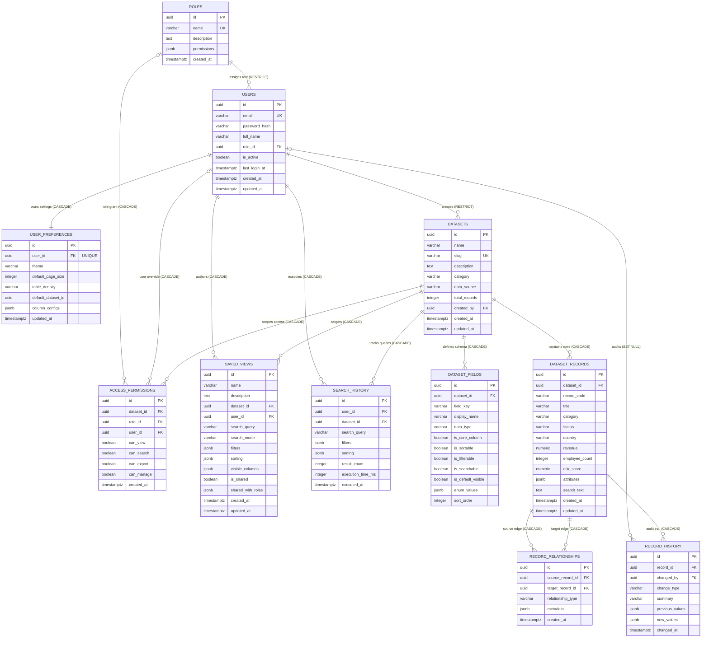

# 04 — Database ER Diagram & Schema Reference

> **Database Engine:** PostgreSQL (Neon Cloud PostgreSQL)  
> **ORM & Migrations:** Drizzle ORM (`apps/api/src/db/schema/*.ts`, `apps/api/src/db/migrate.ts`)  
> **Required Extensions:** `pgcrypto` (UUID generation), `pg_trgm` (trigram inverted text indexes)

---

## 1. Entity-Relationship Diagram (All 11 Tables)

---

## 2. Schema Reference by Domain

### 2.1 Identity, RBAC & User Workspace Preferences (`apps/api/src/db/schema/users.ts`)

#### `roles`
| Column | Type | Constraints / Default | Purpose |
| :--- | :--- | :--- | :--- |
| `id` | `uuid` | `PRIMARY KEY DEFAULT gen_random_uuid()` | Role primary key |
| `name` | `varchar(50)` | `NOT NULL UNIQUE` | `'ADMIN' \| 'ANALYST' \| 'VIEWER'` |
| `description` | `text` | `NOT NULL` | Role responsibilities summary |
| `permissions` | `jsonb` | `NOT NULL DEFAULT '[]'` | Global capability string array |
| `created_at` | `timestamptz` | `NOT NULL DEFAULT now()` | Creation timestamp |

#### `users`
| Column | Type | Constraints / Default | Purpose |
| :--- | :--- | :--- | :--- |
| `id` | `uuid` | `PRIMARY KEY DEFAULT gen_random_uuid()` | User primary key |
| `email` | `varchar(255)` | `NOT NULL UNIQUE` | Normalized lowercase login identifier |
| `password_hash` | `varchar(255)` | `NOT NULL` | `bcryptjs` hash (`10` salt rounds) |
| `full_name` | `varchar(150)` | `NOT NULL` | Display name |
| `role_id` | `uuid` | `NOT NULL REFERENCES roles(id) ON DELETE RESTRICT` | Assigned global role |
| `is_active` | `boolean` | `NOT NULL DEFAULT true` | Account activation toggle |
| `last_login_at` | `timestamptz` | `NULL` | Most recent login timestamp |
| `created_at` | `timestamptz` | `NOT NULL DEFAULT now()` | Registration timestamp |
| `updated_at` | `timestamptz` | `NOT NULL DEFAULT now()` | Profile/role modification timestamp |

#### `user_preferences`
| Column | Type | Constraints / Default | Purpose |
| :--- | :--- | :--- | :--- |
| `id` | `uuid` | `PRIMARY KEY DEFAULT gen_random_uuid()` | Preference row UUID |
| `user_id` | `uuid` | `NOT NULL UNIQUE REFERENCES users(id) ON DELETE CASCADE` | One-to-one owner reference |
| `theme` | `varchar(20)` | `NOT NULL DEFAULT 'dark'` | `'dark' \| 'light' \| 'system'` |
| `default_page_size` | `integer` | `NOT NULL DEFAULT 50` | Preferred grid page size (`10`–`500`) |
| `table_density` | `varchar(20)` | `NOT NULL DEFAULT 'compact'` | `'compact' \| 'comfortable' \| 'spacious'` |
| `default_dataset_id` | `uuid` | `NULL` | Initial dataset auto-selected on workspace load |
| `column_configs` | `jsonb` | `NOT NULL DEFAULT '{}'` | Per-dataset `{ visibleColumns, columnSizing }` map |
| `updated_at` | `timestamptz` | `NOT NULL DEFAULT now()` | Preference save timestamp |

---

### 2.2 Datasets, Dynamic Field Definitions & Permissions (`apps/api/src/db/schema/datasets.ts`)

#### `datasets`
| Column | Type | Constraints / Default | Purpose |
| :--- | :--- | :--- | :--- |
| `id` | `uuid` | `PRIMARY KEY DEFAULT gen_random_uuid()` | Dataset UUID |
| `name` | `varchar(200)` | `NOT NULL` | Human-readable dataset title |
| `slug` | `varchar(200)` | `NOT NULL UNIQUE` | URL-safe unique slug |
| `description` | `text` | `NOT NULL` | Collection summary |
| `category` | `varchar(100)` | `NOT NULL` | Domain category (e.g., `'Enterprise Accounts'`) |
| `data_source` | `varchar(150)` | `NOT NULL` | Upstream ingestion source |
| `total_records` | `integer` | `NOT NULL DEFAULT 0` | Precomputed record count for `O(1)` unfiltered page counts |
| `created_by` | `uuid` | `NOT NULL REFERENCES users(id) ON DELETE RESTRICT` | Creator admin user |
| `created_at` | `timestamptz` | `NOT NULL DEFAULT now()` | Creation timestamp |
| `updated_at` | `timestamptz` | `NOT NULL DEFAULT now()` | Modification timestamp |

#### `dataset_fields`
Stores schema metadata driving dynamic table columns, sortable headers, highlight behavior, and allowed filter operators (`string`, `number`, `currency`, `date`, `enum`, `boolean`). Columns with `is_core_column = true` bind directly to top-level B-Tree columns on `dataset_records`; `is_core_column = false` binds to `dataset_records.attributes`.

#### `access_permissions`
Enforces fine-grained dataset grants (`can_view`, `can_search`, `can_export`, `can_manage`). Evaluated by `resolveEffectiveDatasetPermissions()` where a user-specific override (`user_id = user.id`) takes precedence over a role-level grant (`role_id = user.roleId AND user_id IS NULL`), while `ADMIN` inherently receives full access.

---

### 2.3 Enterprise Records, Relationships & Audit Trail (`apps/api/src/db/schema/records.ts`)

#### `dataset_records`
Hybrid storage design combining strongly typed B-Tree core columns (`record_code`, `title`, `category`, `status`, `country`, `revenue NUMERIC(15,2)`, `employee_count INTEGER`, `risk_score NUMERIC(5,2)`, `created_at`, `updated_at`), semi-structured `attributes JSONB` for dataset-specific fields, and denormalized `search_text TEXT` powering single-table FTS and trigram searches.

#### `record_relationships` & `record_history`
- `record_relationships` captures directed entity graph links (`source_record_id`, `target_record_id`, `relationship_type`, `metadata`) queried bidirectionally (`source = id OR target = id`) in `records.service.ts`.
- `record_history` records immutable change audit entries (`change_type`, `summary`, `previous_values`, `new_values`, `changed_by`, `changed_at`).

---

### 2.4 Collaboration & Telemetry (`apps/api/src/db/schema/views.ts`)

- **`saved_views`**: Stores serialized `{ searchQuery, searchMode, filters, sorting, visibleColumns }` configurations along with visibility flags (`is_shared`, `shared_with_roles`).
- **`search_history`**: Stores executed Page 1 query telemetry (`search_query`, `filters`, `sorting`, `result_count`, `execution_time_ms`, `executed_at`) feeding both user Search History and `/analytics/overview` usage metrics.

---

## 3. Complete Index Catalog (`apps/api/src/db/migrate.ts`)

| Table | Index Name | Engine Type | Key Expression / Columns | Acceleration Role |
| :--- | :--- | :---: | :--- | :--- |
| `users` | `idx_users_role_id` | B-Tree | `(role_id)` | Admin user list & auth role joins |
| `users` | `idx_users_email` | B-Tree | `(email)` | Credential lookup at login |
| `datasets` | `idx_datasets_category` | B-Tree | `(category)` | Dataset library category filtering |
| `datasets` | `idx_datasets_created_by` | B-Tree | `(created_by)` | Creator lookup |
| `dataset_fields` | `idx_dataset_fields_dataset_id` | B-Tree | `(dataset_id, sort_order)` | Ordered field schema loading |
| `access_permissions` | `idx_access_permissions_dataset_role` | B-Tree | `(dataset_id, role_id)` | Role-based permission check |
| `access_permissions` | `idx_access_permissions_dataset_user` | B-Tree | `(dataset_id, user_id)` | User override permission check |
| `dataset_records` | `idx_records_composite_discovery` | B-Tree | `(dataset_id, status, country, revenue, created_at)` | Combined structured filter + revenue sort |
| `dataset_records` | `idx_records_dataset_category_status` | B-Tree | `(dataset_id, category, status)` | Category/status filters & SQL `GROUP BY` |
| `dataset_records` | `idx_records_cursor_pagination` | B-Tree | `(dataset_id, created_at DESC, id DESC)` | Deterministic keyset cursor seek |
| `dataset_records` | `idx_records_dataset_code` | B-Tree | `(dataset_id, record_code)` | Exact business ID lookup |
| `dataset_records` | `idx_records_dataset_revenue` | B-Tree | `(dataset_id, revenue)` | Revenue range & sorting |
| `dataset_records` | `idx_records_dataset_employees` | B-Tree | `(dataset_id, employee_count)` | Headcount range & sorting |
| `dataset_records` | `idx_records_fts_gin` | **GIN** | `(to_tsvector('english', search_text))` | Full-text stemmed & prefix search |
| `dataset_records` | `idx_records_trigram_gin` | **GIN (`pg_trgm`)** | `(search_text gin_trgm_ops)` | Sub-word `ILIKE '%term%'` search |
| `dataset_records` | `idx_records_code_trigram_gin` | **GIN (`pg_trgm`)** | `(record_code gin_trgm_ops)` | Partial code `ILIKE` match |
| `dataset_records` | `idx_records_attributes_gin` | **GIN (`jsonb_path_ops`)** | `(attributes jsonb_path_ops)` | Dynamic attribute `@>` equality containment |
| `record_relationships` | `idx_relationships_source`, `idx_relationships_target` | B-Tree | `(source_record_id)`, `(target_record_id)` | Bidirectional record relationship graph |
| `record_history` | `idx_record_history_record_id` | B-Tree | `(record_id, changed_at DESC)` | Ordered record audit timeline |
| `saved_views` | `idx_saved_views_dataset_user`, `idx_saved_views_shared` | B-Tree | `(dataset_id, user_id)`, `(dataset_id, is_shared)` | Personal & team-shared view lookup |
| `search_history` | `idx_search_history_user_executed`, `idx_search_history_dataset_executed` | B-Tree | `(user_id, executed_at DESC)`, `(dataset_id, executed_at DESC)` | Recent query log & analytics telemetry |
