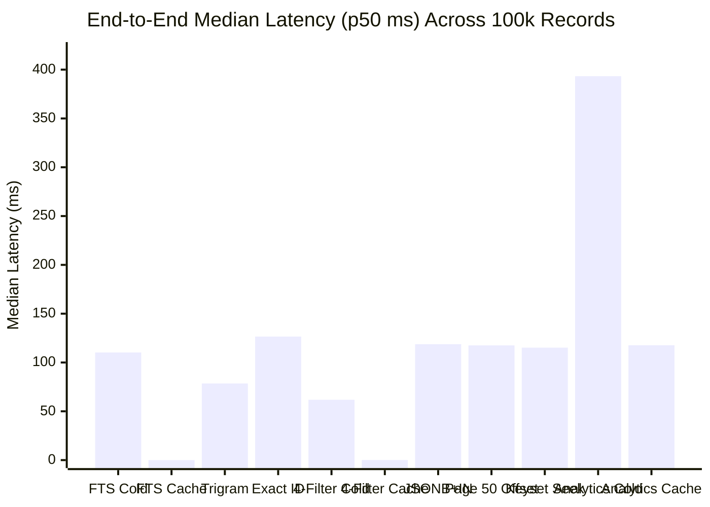

# 07 — Performance Test Report

> **Benchmark Run Timestamp:** `2026-11-16T06:58:40.108Z`  
> **Benchmark Suite:** `pnpm benchmark` (`apps/api/tests/benchmark-100k.ts`)  
> **Target Database:** Managed Cloud PostgreSQL  
> **Verified Dataset Volume:** `100,000` rows in `Global Enterprise Intelligence Directory` (`104,000` total records across workspace datasets)  
> **Test Suite Run:** `pnpm turbo run test --force` (`39/39` passing tests across `5` test files in `apps/api` and `apps/web`)

---

## 1. Executive Summary

Performance testing across `100,000+` enterprise records demonstrates that DataScope satisfies sub-second interactive query and analytical workloads over Cloud PostgreSQL while reducing repeat query overhead to sub-millisecond server cache hits:

- **In-Engine Database Query Execution (`EXPLAIN (ANALYZE, BUFFERS)`):** Indexed searches and pagination execute in `0.129 ms` (Keyset Cursor Seek), `0.216 ms` (4-condition Section 3.C composite filter), and `12.307 ms` (Global Full-Text Search `tsvector`).
- **End-to-End Application Search Latency (Cold Cloud DB Round-Trip p50):** `61.8 ms` to `126.53 ms` across all query, trigram, exact lookup, JSONB, offset, and keyset seek scenarios (including TLS cloud database network RTT).
- **Server Search Result Cache Speedup (`TtlCache`, 120s TTL, 500 LRU):** Warm `fts` cache hits drop p50 latency from `110.25 ms` to `0.01 ms` (**`~11,025x`** faster), and warm 4-condition filter cache hits drop from `61.8 ms` to `0.05 ms` (**`1,236x`** faster).
- **Parallel Analytics Aggregations:** Cold 6-query SQL aggregations (`GROUP BY` + cumulative window sum + `jsonb_array_elements`) over `100,000` records complete in `393.29 ms` p50; warm RBAC-validated cache hits execute in `117.62 ms` p50 (**`~3.3x`** faster while still validating live dataset permissions against PostgreSQL on every call).

---

## 2. End-to-End Benchmark Results (`100,000` Records)

### Detailed Latency Distribution (`Min / p50 / p95 / Max`)

| # | Scenario | Mode | Runs | Min | **p50 (Median)** | p95 | Max | Matched Rows | Backing Index / Mechanism |
| :---: | :--- | :--- | :---: | :---: | :---: | :---: | :---: | :---: | :--- |
| 1 | Global Full-Text Search (`"Quantum"`) | Cold DB Query | 10 | 106.12 ms | **110.25 ms** | 167.95 ms | 167.95 ms | 3,125 | GIN `idx_records_fts_gin` (`tsvector` + prefix `:*`) |
| 2 | Global Full-Text Search (Cache Hit) | Warm Server Cache Hit | 25 | 0.01 ms | **0.01 ms** | 0.03 ms | 0.08 ms | 3,125 | `searchResultCache` (`TtlCache`, 120s TTL, 500 LRU) |
| 3 | Trigram Partial Search (`"Synthet"`) | Cold DB Query | 10 | 72.89 ms | **78.5 ms** | 365.93 ms | 365.93 ms | 3,125 | GIN `pg_trgm` (`search_text` / `record_code`) |
| 4 | Exact Match Lookup (`"ENT-050000"`) | Cold DB Query | 10 | 123.06 ms | **126.53 ms** | 140.33 ms | 140.33 ms | 1 | B-Tree `idx_records_dataset_code` |
| 5 | Section 3.C Combined Filter (`AND x4`) | Cold DB Query | 10 | 59.91 ms | **61.8 ms** | 207.86 ms | 207.86 ms | 831 | Composite B-Tree `idx_records_composite_discovery` |
| 6 | Section 3.C Combined Filter (Cache Hit) | Warm Server Cache Hit | 25 | 0.04 ms | **0.05 ms** | 0.09 ms | 0.11 ms | 831 | `searchResultCache` warm hit |
| 7 | Dynamic JSONB (`region = EMEA`) + `IN` | Cold DB Query | 10 | 71.94 ms | **118.78 ms** | 212.81 ms | 212.81 ms | 16,667 | GIN `jsonb_path_ops` (`@>`) + B-Tree |
| 8 | Multi-Sort Offset Pagination (Page 1) | Cold DB Query | 10 | 112.44 ms | **118.58 ms** | 129.42 ms | 129.42 ms | 100,000 | `OFFSET 0` + `O(1)` `datasets.total_records` metadata |
| 9 | Multi-Sort Offset Pagination (Page 50) | Cold DB Query | 10 | 64.93 ms | **117.53 ms** | 253.04 ms | 253.04 ms | 100,000 | `OFFSET 2450` over `100k` records |
| 10 | Keyset Cursor Pagination (10 Steps) | Cold DB Seek | 10 | 64.01 ms | **115.23 ms** | 126.35 ms | 126.35 ms | 100,000 | `idx_records_cursor_pagination` `(created_at, id) < cursor` |
| 11 | SQL Analytics Aggregations (6+ Panels) | Cold Parallel SQL | 6 | 372.86 ms | **393.29 ms** | 408.31 ms | 408.31 ms | 100,000 | `Promise.all` parallel `GROUP BY` + window functions |
| 12 | SQL Analytics Aggregations (Cache Hit) | Warm 60s TTL Cache | 20 | 115.97 ms | **117.62 ms** | 127.64 ms | 133.72 ms | 100,000 | Live RBAC check + `analyticsCache` (`60s` TTL) |

> **Latency Decomposition Note:** End-to-end times above (~60–126 ms for cold single queries; ~117 ms for warm analytics RBAC checks) are dominated by TLS TCP network round-trip latency between the API host and remote Managed Cloud PostgreSQL. PostgreSQL server-side query execution alone takes `< 13 ms` (Section 3). On Analytics cache hits (`#12`), `getAnalyticsOverview` executes live RBAC queries (`listDatasetsForUser` + `resolveEffectiveDatasetPermissions`) prior to reading `analyticsCache`, ensuring immediate revocation enforcement at `~3.3x` speedup over full aggregation scans.

---

## 3. PostgreSQL `EXPLAIN (ANALYZE, BUFFERS)` Plan Verification

### 3.1 Global Full-Text Search (`"Quantum"`, `LIMIT 50`)
- **Planning Time:** `1.049 ms` · **Execution Time:** **`12.307 ms`** · **Buffers:** `shared hit=1326`
- Uses `Index Scan using idx_records_cursor_pagination` on `dataset_id` combined with `to_tsvector('english', search_text) @@ '''quantum'''::tsquery`, returning the newest 50 rows early once 50 matches satisfy the filter (`Rows Removed by Filter: 1256`).

### 3.2 Section 3.C Canonical 4-Condition Filter (`status = Active AND country = Germany AND revenue > 10000 AND created_at BETWEEN ...`)
- **Planning Time:** `0.193 ms` · **Execution Time:** **`0.216 ms`** · **Buffers:** `shared hit=65`
- Uses `Index Scan Backward using idx_records_composite_discovery` directly matching `(dataset_id, status, country, revenue, created_at)` with zero sequential scans and an in-memory `Incremental Sort` (`quicksort`, `Peak Memory: 29kB`) on presorted `revenue DESC`.

### 3.3 Keyset Cursor Pagination Seek (`ORDER BY created_at DESC, id DESC LIMIT 50`)
- **Planning Time:** `0.120 ms` · **Execution Time:** **`0.129 ms`** · **Buffers:** `shared hit=54`
- Uses a pure forward `Index Scan using idx_records_cursor_pagination` touching only `54` shared buffers without scanning or discarding prior rows.

---

## 4. Automated Test & Build Verification Matrix

All automated quality gates were executed after the latest code commit (`5f544f9`) and passed cleanly:

| Verification Gate | Command | Scope & Result | Duration |
| :--- | :--- | :--- | :---: |
| **TypeScript Static Check** | `pnpm typecheck` | `3/3` packages passed (`@datascope/shared`, `@datascope/api`, `@datascope/web`) | `24.39 s` |
| **Workspace Lint** | `pnpm lint` | `3/3` packages passed (`tsc --noEmit` across workspaces) | `11.22 s` |
| **Backend Integration & Unit Tests** | `pnpm turbo run test --force` (`@datascope/api`) | **`24/24` passed** across 3 files: `search-filters-pagination.test.ts` (13), `auth-rbac.test.ts` (7), `saved-views-analytics.test.ts` (4) | `46.68 s` |
| **Frontend Store & BFF Proxy Tests** | `pnpm turbo run test --force` (`@datascope/web`) | **`15/15` passed** across 2 files: `store-and-caching.test.ts` (9), `api-proxy.test.ts` (6) | `7.07 s` |
| **Production Monorepo Build** | `pnpm build` | `3/3` packages built cleanly (Next.js: `/explorer` `212 kB` first-load, `/analytics` `286 kB`, `/api/v1/[...path]` `103 kB`, Middleware `40.5 kB`) | `1m 17.87 s` |
| **GitHub Actions CI/CD** | Workflow Run `#43710752131` | `main` branch full migration, 100k seed, test & production build passed | `1m 39 s` |

---

## 5. Observed Constraints & Next-Stage Optimization Roadmap

1. **Free-Tier Compute & Network Co-Location:** On free-tier Render (`apps/api`) and Vercel (`apps/web`) separated from Neon region or subject to Render cold starts, cold API requests incur ~60–126 ms remote DB RTT plus initial container spin-up if idle. Co-locating Render and Neon in the same AWS region cuts per-query RTT from `~60 ms` to `< 5 ms`.
2. **Filtered `COUNT(*)` Cost Above `5M–10M` Rows:** Unfiltered counts are already `O(1)` via `datasets.total_records`, whereas arbitrary multi-filter queries run exact `count(*)::int`. Above 10M rows, replacing exact counts on deep filters with approximate planner estimates or cursor "hasNext (`LIMIT pageSize + 1`)" removes full-count latency spikes.
3. **Single-Process In-Memory `TtlCache`:** Current caches operate per Node process (`500` search entries, `100` analytics entries). Scaling `apps/api` to multiple horizontal instances should replace `TtlCache` with Redis so invalidations propagate fleet-wide.
